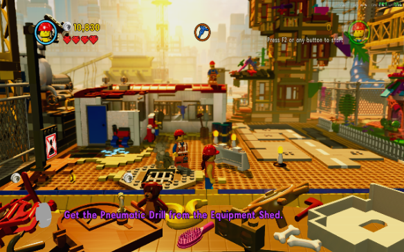

# NuVulkanBackend

A native **Vulkan 1.3** drop-in `d3d9.dll` replacement for the Direct3D 9 renderer in *The LEGO Movie - Videogame* (`LEGOEMMET.exe`, Traveller's Tales NuEngine). No DXVK, WineD3D, or Gallium Nine — all D3D9 calls are translated directly to Vulkan 1.3 dynamic rendering.



## Features

- **Native D3D9-to-Vulkan 1.3 Translation**
  - Direct `IDirect3D9` / `IDirect3DDevice9` vtable implementation verified at compile time against the executable's observed vtable offsets (`src/d3d9_vtable.h`, `tools/gen_d3d9_slots.py`).
  - On-the-fly Shader Model 3.0 (`vs_3_0` / `ps_3_0`) to **SPIR-V 1.3** compiler (`src/sm3_to_spirv.cpp`) with persistent on-disk shader caching (`src/shaders.cpp`).
  - Lock-free 257-register uniform buffer ring (`src/constants.cpp`), XXH64 graphics PSO cache (`src/pso_cache.cpp`), dual-frame-in-flight command recording, and Vulkan Memory Allocator (`VMA`) resource management (`src/resources.cpp`).
  - Automatic NaN/Inf sanitization on vertex shader outputs to prevent geometry explosions.

- **Ground-Truth Ambient Occlusion (GTAO)**
  - Half-resolution 6-slice horizon-based ambient occlusion with interleaved gradient noise (`src/post_fx.cpp`).
  - Separable 7-tap depth-aware bilateral blur for clean contact shadows between studs, bricks, minifigures, and street corners without halo artifacts.

- **ABS Plastic Micro-Roughness & Lighting Enhancement**
  - 3D shader post-hook in `src/sm3_to_spirv.cpp` and screen-space normal/ViewDir shading in `src/post_fx.cpp` adding Schlick Fresnel rim highlights, ABS plastic specular catchlights, subtle micro-grain roughness variation, and cool bounce lighting.

- **Hybrid SMAA + FXAA 3.11 Edge Anti-Aliasing**
  - Multi-pass perceptual luminance edge detection (`BuildSmaaEdgesFs`), 12-step morphological span weighting (`BuildSmaaWeightsFs`), and 3x3 gradient-directed FXAA edge-tangent search + subpixel smoothing (`BuildSmaaBlendAndAcesFs`).
  - Executed via scene/HUD boundary detection (`FlushBeforeHud`) so 3D edges are smoothed while 2D HUD, portraits, and text remain crisp at native resolution.

- **ACES Filmic Tone Mapping, Haze & Sun Shafts**
  - ACES filmic tone curve with shadow-weighted vibrance and S-curve grading.
  - Depth-masked atmospheric distance haze and radial sun shafts in 3D outdoor scenes.

- **16x Anisotropic Filtering & World Sampler Sharpening**
  - Upgrades 3D world samplers to `16x` anisotropic filtering with `-0.5` mip LOD bias (`src/d3d9_draw.cpp`).

- **Stud Contact Shadows & In-Game FPS Counter**
  - Depth-sampled contact shadows under collectible studs (`src/stud_shadows.cpp`) and an integrated corner FPS overlay (`src/fps_overlay.cpp`).

## Subsystems

| File | Responsibility |
|---|---|
| `src/dllmain.cpp` | IAT hook, logger (`d3d9.log`), `Direct3DCreate9` proxy exports |
| `src/d3d9_factory.cpp` | Fake `IDirect3D9`, device creation, swapchain and query objects |
| `src/d3d9_device.cpp` | `IDirect3DDevice9` vtable, render states, constants, state blocks |
| `src/d3d9_draw.cpp` | Pipeline state key, draw translation, `16x` AF sampler setup, post-FX hooks |
| `src/d3d9_internal.h` | Shared device state and internal structures |
| `src/vk_context.cpp` | Vulkan 1.3 instance/device, swapchain, dynamic rendering, frames in flight |
| `src/constants.cpp` | 257-register VS/PS uniform blocks in a persistently mapped dynamic ring |
| `src/resources.cpp` | Buffer, texture, cube, volume, and surface management via VMA |
| `src/shaders.cpp` | XXH64 shader hashing and disk SPIR-V cache |
| `src/sm3_to_spirv.cpp` | SM3 bytecode -> SPIR-V 1.3 translator and ABS plastic shader enhancement |
| `src/pso_cache.cpp` | XXH64 pipeline state hash -> `VkPipeline` cache |
| `src/post_fx.cpp` | GTAO, bilateral blur, ABS specular/rim/haze, SMAA + FXAA 3.11, ACES |
| `src/stud_shadows.cpp` | Projected depth-aware contact shadows for studs |
| `src/fps_overlay.cpp` | Integrated bitmap-font FPS overlay |

## Installation

1. Download `NuVulkanBackend-v1.0.0.zip` (or `d3d9.dll`) from the [Releases](https://github.com/LeroyExel/NuVulkanBackend/releases) page.
2. Copy `d3d9.dll` into your *The LEGO Movie - Videogame* installation folder next to `LEGOEMMET.exe`.
3. Launch `LEGOEMMET.exe`. First launch compiles and caches SPIR-V shaders into `shaders/`.

## Building from Source

Requires MSVC (x86) and CMake. Vulkan headers, VMA, and xxHash are vendored under `vendor/`; `vulkan-1.dll` is loaded dynamically at runtime.

```sh
cmake -S . -B build -A Win32
cmake --build build --config Release
```

The compiled 32-bit DLL is written to `build/Release/NuVulkanBackend.dll` and can be copied next to `LEGOEMMET.exe` as `d3d9.dll`. Or inject dynamically:

```powershell
tools\inject.ps1 -Process LEGOEMMET
```
